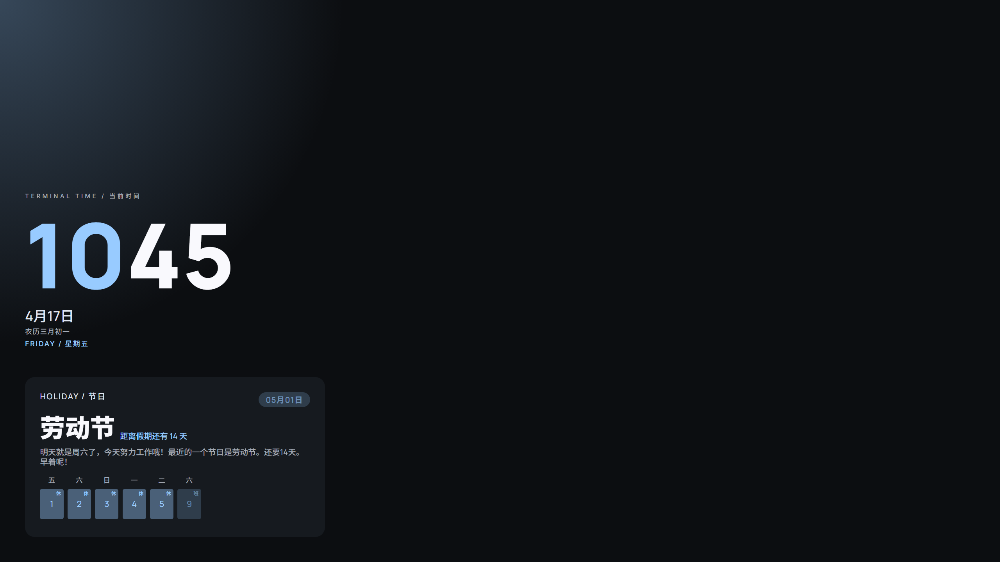

<div align="center">
  
  &nbsp;
  <strong>NewTaber（Vue3 + TypeScript）</strong>
</div>

<br>

<div style="display: flex; align-items: center;justify-content: center;margin: 30px 0;">
  
</div>

<br>

# Chrome New Tab Page Extension

现代化 Chrome 新标签页扩展，提供节日展示和系统主题自适应功能。

## 功能特性

- ✨ **节日动态展示**：根据当前日期自动显示节假日信息
- 🌓 **智能主题切换**：自动跟随系统设置的白天/夜间模式
- 🎨 **全新首页设计**：基于 Vue3 重构的现代化界面
- ⚡ **轻量高效**：优化性能与资源占用

## 扩展资源

### 节假日数据

三级数据源，优先级由高到低，**永不为空**：

| 优先级 | 来源 | 说明 |
|---|---|---|
| 1 | `localStorage` | 服务器最近一次成功拉取，**永不过期** |
| 2 | `src/data/holidays.json` | 打包内置种子，当前年 ±1 年 |
| 3 | 空态 | 仅当 1、2 都无效（正常路径不可达） |

数据链路：

```
国务院办公厅公告（每年 11 月初）
  → chinese-days 当天同步（上游，MIT）
  → 服务器 cron 每天一次拉取并生成 holiday.json
  → 扩展开新标签时后台刷新（缓存周期 24 小时）
```

全程不需要重新打包、刷新或重装扩展，公告后最坏约 2 天生效（服务器次日 07:15 拉取 + 扩展 24 小时缓存）。

- 结构：`HolidayDataset { version, generated_at, years, holidays }`，`holidays[date] = { type, week, name }`，`type` 2=休 3=班
- 拉取失败（断网 / 超时 / 服务器不可用）→ **保持原有数据不变**，静默降级
- 节假日名称采用上游原样名（如「中秋」而非「中秋节」）

### 配置服务器地址

服务器地址不写在代码里，通过 `.env` 注入：

```bash
cp .env.example .env
# 编辑 .env
VITE_HOLIDAY_API=https://你的域名/holiday/holiday.json
```

- `.env` 已被 gitignore，不会提交
- 留空 = 不请求远程，仅使用内置种子
- 构建时自动校验并写入 `manifest.json` 的 `host_permissions`（必须 HTTPS，非法配置直接构建失败）

### 部署数据服务（服务器侧）

1. 上传 `server/build-holiday.mjs` 与 `server/update.sh` 到 `/opt/holiday/`
2. 手动跑一次验证：
   ```bash
   /opt/holiday/update.sh /var/www/holiday/holiday.json
   curl -i https://你的域名/holiday/holiday.json
   ```
3. 配置 crontab（每天一次）：
   ```cron
   15 7 * * * /opt/holiday/update.sh /var/www/holiday/holiday.json >> /var/log/holiday.log 2>&1
   ```
   国务院一年只发布一次（11 月初），上游偶有年中补丁，故每日一次足够；脚本幂等，内容没变不会写文件，失败次日自动重试。想更省可改为每周一：`15 7 * * 1`。
4. nginx 开启 CORS 与缓存：
   ```nginx
   location /holiday/ {
       root /var/www;
       add_header Access-Control-Allow-Origin * always;
       add_header Cache-Control "public, max-age=3600";
   }
   ```

### 更新内置种子数据

种子只在「服务器从未成功过」时生效，每年发版前更新一次即可：

```bash
npm run update:seed
```

## 安装指南

1. 克隆项目：
   ```bash
   git clone https://github.com/your-username/chrome-extension-newtab.git
   cd chrome-extension-newtab
   ```
2. 安装依赖：
   ```bash
   npm install
   ```
3. 配置数据接口（可选，留空则只用内置种子）：
   ```bash
   cp .env.example .env
   ```
4. 构建生产版本：
   ```bash
   npm run build
   ```
5. 在 Chrome 中加载扩展：
   - 打开 `chrome://extensions`
   - 启用开发者模式
   - 点击"加载已解压的扩展程序"
   - 选择 `NewTaber_v3.0.0` 目录

## 开发环境

```bash
# 启动开发服务器
npm run dev

# 打包生产版本（产物直接输出到 NewTaber_v3.0.0/）
npm run build

# 更新内置节假日种子
npm run update:seed
```

## 项目结构

```
├── public/               # 静态资源（manifest.json / background.js / images）
├── scripts/
│   ├── build-seed.mjs    # 生成内置种子数据
│   └── apply-config.mjs  # 构建后按 .env 写入 manifest host_permissions
├── server/               # 服务器侧数据生成脚本
├── src/
│   ├── data/holidays.json    # 内置种子数据
│   ├── utils/holidayData.ts  # 三级数据源 + 缓存 + 拉取
│   └── views/                # 页面组件
├── NewTaber_v3.0.0/      # 构建输出，可直接加载的扩展目录（不入库，需自行构建）
└── package.json
```

> 本项目基于 Vue3 构建，使用现代前端技术栈开发。\
> 当前版本：v3.0.0 | 最后更新：2026-04-14
